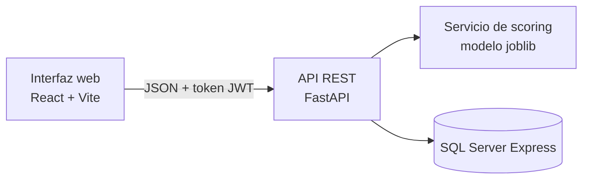

# CrediCheck

**Simulador de riesgo crediticio con educación financiera.** Proyecto Capstone de Ingeniería en Informática, Duoc UC (2026).

CrediCheck permite a una persona estimar, antes de pedir un crédito, la probabilidad de caer en **mora grave** (90 días o más de atraso en dos años). No se limita a entregar un número: explica qué factores influyen, muestra qué pasaría si mejora sus hábitos financieros (escenario *"si mejoras"*) y ofrece una sección educativa.

> **Aviso:** CrediCheck es una herramienta educativa. No aprueba ni rechaza créditos y no reemplaza la evaluación de una institución financiera. El modelo se entrenó con datos públicos de Estados Unidos (2011), por lo que sus resultados son referenciales.

## Qué hace

- **Simula sin cuenta:** ingreso, cuotas y gastos fijos, tarjetas, créditos abiertos y atrasos. No pide RUT ni nombre.
- **Entrega la probabilidad de mora grave** y un nivel de riesgo: bajo (menos de 3 %), medio (3 % a 10 %) o alto (más de 10 %), comparado con el promedio de referencia (≈ 6,9 %).
- **Explica y orienta:** indica cuánto baja el riesgo si el uso de tarjetas y la carga de deuda llegan a niveles saludables, y qué aporta cada cambio por separado.
- **Guarda un historial** para usuarios registrados, con verificación de correo mediante código.
- **Educa:** sección *Aprende* con los conceptos clave.

## Tecnologías

| Capa | Tecnologías |
|---|---|
| Interfaz | React, Vite, react-router, CSS Modules, Context API |
| API | Python, FastAPI, Pydantic, Uvicorn |
| Datos | SQL Server Express, SQLAlchemy 2.0, pyodbc (ODBC Driver 18) |
| Modelo | scikit-learn (HistGradientBoosting con restricciones monótonas), pandas, joblib |
| Seguridad | JWT (PyJWT), bcrypt, verificación de correo por código, CORS restringido, límite de solicitudes por IP |
| Calidad | pytest, Locust, pip-audit, npm audit |

## Arquitectura

Aplicación de tres capas con un servicio de *scoring* que carga el modelo desde un archivo, de modo que el modelo puede reentrenarse sin modificar la interfaz.



Flujo de una simulación: el formulario envía los datos a la API; Pydantic los valida; el servicio limita valores extremos y consulta el modelo; la API devuelve probabilidad, nivel y escenario "si mejoras"; si el usuario tiene sesión, puede guardar la simulación en su historial.

## El modelo

- **Datos:** *Give Me Some Credit* (≈ 150 mil registros, EE. UU., 2011), 7 variables de comportamiento crediticio.
- **Método:** CRISP-DM. Gradient boosting con restricciones monótonas (por ejemplo, más atrasos nunca bajan el riesgo).
- **Desempeño:** AUC de 0,850 en datos de prueba y 0,849 con validación cruzada.
- **Variables excluidas:** edad, sexo, estado civil y dependientes.
- **Salida:** probabilidad de mora grave, no una decisión de aprobación.

## Seguridad

- Contraseñas con hash bcrypt.
- Sesión con token JWT de 60 minutos.
- Verificación de correo con código de 6 dígitos (vence en 15 minutos, máximo 5 intentos, reenvío con espera de 60 segundos).
- Límites de solicitudes por IP: 10 inicios de sesión por minuto, 5 registros por hora, 10 códigos cada 10 minutos y 30 simulaciones por minuto.
- Cada usuario solo accede a sus propias simulaciones. CORS acepta solo el origen autorizado.
- El diseño considera los principios de la Ley N.° 21.719 de protección de datos personales.

## Instalación y ejecución local

### Requisitos

- Python 3.12, Node.js y npm
- SQL Server Express en ejecución y ODBC Driver 18 for SQL Server

### 1. Backend

```powershell
cd backend
python -m venv .venv
.venv\Scripts\Activate.ps1
python -m pip install -r requirements.txt
```

Crea un archivo `.env` en la carpeta `backend` (no lo subas al repositorio):

```env
JWT_SECRET=<clave larga y aleatoria>
# Datos de conexión a SQL Server y, opcionalmente, del servidor de correo (SMTP):
# revisa app/core/config.py para ver los nombres exactos de cada variable.
```

Para generar una clave segura:

```powershell
python -c "import secrets; print(secrets.token_hex(32))"
```

Inicia la API:

```powershell
python -m uvicorn app.main:app --port 8000
```

La documentación interactiva queda en `http://127.0.0.1:8000/docs`.

> **Correo en desarrollo:** si no hay un servidor SMTP configurado, el código de verificación se imprime en la consola del backend (*modo desarrollo*).

### 2. Frontend

```powershell
cd frontend
npm install
npm run dev
```

La interfaz queda en `http://localhost:5173`.

### 3. Docker

> Despliegue con Docker y Docker Compose: en preparación.

## Pruebas

```powershell
cd backend

# Unitarias, de integración y de seguridad (24 pruebas)
python -m pip install pytest httpx
python -m pytest tests -v

# Rendimiento (servidor encendido en otra terminal)
python -m locust -f rendimiento/locustfile.py --headless -u 100 -r 10 -t 2m --host http://127.0.0.1:8000

# Seguridad de dependencias
python -m pip_audit          # en backend
npm audit --omit=dev         # en frontend
```

Para las pruebas de carga se desactivan los límites de solicitudes con `LIMITES_ACTIVOS=false` en el entorno, de lo contrario Locust recibe errores 429.

**Resultados:** 24 de 24 pruebas automáticas aprobadas; 10.642 solicitudes de carga y estrés sin errores (hasta 100 usuarios simultáneos); auditorías de dependencias sin vulnerabilidades; 10 casos funcionales manuales sobre la interfaz. El detalle está en el documento *Plan de Pruebas y Evidencias*.

**Limitaciones conocidas:** no se ejecutó un escaneo dinámico con OWASP ZAP; las pruebas de carga se hicieron en un solo equipo y antes de agregar los límites de solicitudes; el límite de solicitudes vive en la memoria de un solo proceso.

## Metodología

Proyecto individual desarrollado con la metodología en **cascada**: requerimientos, diseño, desarrollo, pruebas y cierre, con un documento por fase.

## Documentación

- Documento de Requerimientos (SRS)
- Documento de Diseño (arquitectura, modelo de datos y diagramas UML)
- Plan de Pruebas y Evidencias
- Manual Técnico y de Despliegue (en preparación)

## Autor

**Daniel Ahumada Ubeda**, Ingeniería en Informática, Duoc UC. Proyecto realizado de forma individual, asumiendo los roles de analista, científico de datos, desarrollador full-stack y responsable de calidad.
